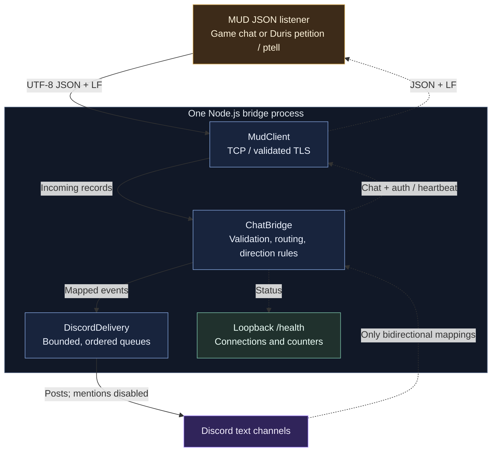

<p align="center">
  <a href="https://github.com/LuminariMUD/discord-mud-chat/actions/workflows/test.yml"></a>
  <a href="package.json">=24.18.0" src="https://img.shields.io/badge/Node.js-%3E%3D24.18.0-5FA04E?style=flat-square&amp;logo=nodedotjs&amp;logoColor=white"></a>
  <a href="package.json">=12.0.1" src="https://img.shields.io/badge/npm-%3E%3D12.0.1-CB3837?style=flat-square&amp;logo=npm&amp;logoColor=white"></a>
  <a href="src/index.js"></a>
  <br>
  <a href="docs/protocol.md"></a>
  <a href="docs/deploy.md#docker-choose-the-namespace-explicitly"></a>
  <a href="ecosystem.config.js"></a>
  <a href="LICENSE.txt"></a>
  <a href="https://github.com/LuminariMUD/discord-mud-chat/pulls"></a>
</p>

# MUD-Discord Chat Bridge

**Bring your MUD's conversations to Discord. Keep control of what comes back.**

A Node.js bridge between a MUD (Multi-User Dungeon) and Discord text channels.
Connect a dedicated JSON endpoint, map your channels, and relay chat in both
directions - or publish an outbound-only feed.

[Quick start](#quick-start) | [How it works](#how-it-works) |
[Configuration](#configuration) | [Deployment](docs/deploy.md) |
[Testing](docs/testing.md)

## Built for your world's conversations

- **Flexible channel routing.** Map case-sensitive MUD channel names to Discord
  channel IDs. Relay both ways by default, or make individual mappings outbound-only.
- **Readable Discord output.** Preserve names and emotes, split long messages at
  Unicode code-point boundaries, and disable mention parsing on every post.
- **Controlled game ingress.** Sanitize Discord mentions, optionally strip emoji,
  and rate-limit by stable Discord user ID and MUD channel.
- **Bounded delivery.** Limit queued records and bytes, handle socket
  backpressure, and reconnect using a configurable fixed delay.
- **Transport and operational visibility.** Validate TLS certificates, support
  optional MUD authentication, and expose local health counters and rotating logs.
- **Integration examples you can exercise.** Use the generic C89/cJSON sample or
  the Duris native integration, each with its own executable checks.

## Choose your integration

**Generic MUD chat:** connect gossip, auction, congratulations, or your own
channels. Mappings are bidirectional unless restricted. Start with the
[MUD requirements](docs/mud_requires.md) and
[tested C89/cJSON sample](docs/mud_example/README.md).

**Duris staff petition feed:** export accepted petitions and staff `ptell`
replies to one staff-only Discord channel. Both the Node mapping and native
Duris endpoint block incoming game chat. Staff reply in the game.
Use the [Duris guide](docs/duris.md) and
[Duris configuration example](config/config.duris.example.json).

A MUD name in an example does not establish upstream compatibility. The generic
sample has an independent harness; Duris has native command and cross-repository
tests. The [implementation handoff](docs/ongoing-projects/duris-petition-compatibility.md)
records verification evidence and remaining live acceptance work.

## How it works

The bridge is a **TCP/TLS client**. Your MUD supplies a dedicated JSON listener,
separate from player Telnet, TLS gameplay, GMCP, or WebSocket ports. Run one
bridge process per endpoint.



Solid arrows show MUD-to-Discord delivery. Dashed arrows show return traffic,
controls, and health updates. A `mud_to_discord` mapping blocks
Discord chat; authentication and heartbeat controls still run. Native Duris also
discards incoming chat.

## Quick start

You need **Node.js >=24.18.0**, **npm >=12.0.1**, a Discord bot, and a MUD JSON
listener. `.nvmrc` selects Node 24.18.0; `packageManager` pins npm 12.0.1.

### 1. Install

```sh
git clone https://github.com/LuminariMUD/discord-mud-chat.git
cd discord-mud-chat
# If you use nvm: nvm install && nvm use
npm ci
cp config/config.example.json config/config.json
cp .env.example .env
```

For Duris, copy `config/config.duris.example.json` to `config/config.json`
instead of the generic example.

### 2. Connect your bot and MUD

Follow the [Discord bot setup](docs/setting_up_discord_bot.md). Enable **Message
Content** and **Server Members** privileged intents; the shared runtime requests
both even for outbound-only mappings. Give the bot View Channel, Send Messages,
and Read Message History in the selected text channels.

Set `DISCORD_TOKEN` in your protected environment or local `.env`. Edit
`config/config.json` with your JSON listener address/port and Discord channel
**IDs**. Keep local configuration and credentials out of Git.

### 3. Start the bridge

```sh
npm start
# Development with automatic restart:
# npm run dev
```

Starting the application logs into Discord and can relay real messages. Check
the intended channel and the local health endpoint:

```sh
curl --fail http://127.0.0.1:3000/health
```

For Duris, complete the [native listener setup and staff audience
checks](docs/duris.md) before sending petitions.

## Configuration

Example configuration with a bidirectional channel and an outbound-only feed:

```json
{
  "mud_name": "Your MUD",
  "mud_ip": "127.0.0.1",
  "mud_port": 8181,
  "mud_tls": false,
  "mud_tls_servername": "",
  "mud_max_record_bytes": 1048576,
  "mud_retry_count": 50,
  "mud_retry_delay": 30000,
  "mud_infinite_retries": true,
  "rate_limit_per_channel": 10,
  "strip_emoji": true,
  "enable_bitly": false,
  "largest_printable_string": 65535,
  "channels": [
    { "discord": "GOSSIP_CHANNEL_ID", "mud": "gossip", "direction": "both" },
    { "discord": "FEED_CHANNEL_ID", "mud": "announcements", "direction": "mud_to_discord" }
  ]
}
```

### Routing and message limits

- `channels[].direction`: omitted or `both` allows both directions;
  `mud_to_discord` exports only. Unknown values fail startup.
- MUD events fan out to **all** mappings with the same case-sensitive `mud`
  name. Discord posts use the **first** mapping for their channel ID; a blocked
  first mapping never falls through. Duplicate mappings can duplicate posts.
- `mud_max_record_bytes`: maximum serialized UTF-8 record bytes before LF in
  either direction; defaults to 1 MiB.
- `largest_printable_string`: incoming Discord content limit in UTF-16 code
  units before sanitization; the supplied examples use 65,535.
- `rate_limit_per_channel`: Discord ingress rate per stable user ID and MUD
  channel; defaults to 10 messages/second.
- `strip_emoji`: strips custom and Unicode emoji from Discord names/content
  when enabled. `enable_bitly` is reserved; URL shortening is not implemented.

### Connections and credentials

- `mud_ip` / `mud_port`: the dedicated JSON endpoint. Plaintext is allowed
  only to literal loopback IPs such as `127.0.0.1` or `::1`, without a MUD token.
- `mud_tls`: enable certificate-validated TLS for hostnames (including
  `localhost`), private addresses, and remote endpoints.
- `mud_tls_servername`: certificate DNS name when connecting by IP.
  Set `NODE_EXTRA_CA_CERTS` **before Node starts** for a private CA.
- `MUD_AUTH_TOKEN`: optional shared token, sourced only from the environment
  and requiring TLS. JSON MUD token fields are ignored.
- `mud_retry_delay`: fixed reconnect delay in milliseconds; the supplied
  examples use 30,000. `mud_retry_count` and `mud_infinite_retries` govern error
  retries. See the [protocol](docs/protocol.md#limits-disconnects-and-delivery)
  for clean-close and retry-reset behavior.

Never disable certificate verification. Container loopback normally belongs to
the container; choose the [deployment topology](docs/deploy.md) explicitly.

## Wire format and delivery

Send one UTF-8 JSON object followed by LF per record:

```json
{"channel":"gossip","name":"Ayla","message":"Hello from the dungeon!","emoted":0}
```

`channel`, `name`, and `message` must be strings. Ordinary output is
`name: message`; numeric `emoted: 1` sends only the message, without automatic
italics. Long Discord output is split into posts of at most 2,000 UTF-16 code
units without breaking Unicode code points.

Delivery is **bounded and best effort**. Each direction admits at most 256
pending records/events and 4 MiB of queued data under its own accounting.
There is no durable queue, outage replay, delivery acknowledgment, or
exactly-once guarantee. Auth and heartbeat are control records, separate from
chat routing. See the [wire protocol](docs/protocol.md) for framing, queue
bounds, failure recovery, and counter semantics.

## Run and monitor

Choose local Node, **one PM2 fork instance**, or Docker. Stop the current process
before starting its replacement; overlapping workers can duplicate delivery.
The [deployment guide](docs/deploy.md) covers TLS, Linux host networking,
container mounts, updates, and rollback.

- **Health:** `GET http://127.0.0.1:3000/health` returns 200 when both connections
  are marked connected, otherwise 503. `HEALTH_PORT` selects another port.
  Health binds to loopback in the process's network namespace.
- **Counters:** successful Discord posts (including split parts), accepted MUD
  writes, and drops are counted separately. Connection health and accepted
  writes do not prove game receipt or authenticated delivery.
- **Logs:** `LOG_LEVEL` controls Winston verbosity. `logs/app.log` and
  `logs/error.log` rotate at 10 MiB with up to seven files per transport.
  Keep tokens and private message bodies out of diagnostics.

## Development and verification

Install the locked dependencies and run the same Node checks used by CI.
OpenSSL must be on `PATH` for tests that generate temporary TLS certificates.

```sh
npm ci
npm run lint
npm run test:coverage
npm audit --audit-level=high
```

The Node suite needs no Discord credentials, local config, or live MUD.
Coverage gates are **95% lines, 90% branches, and 85% functions**.
[GitHub Actions](.github/workflows/test.yml) runs Node 24.18.0 and 26.8.1,
a generic C89 sample job with sanitizers, and a production-container exercise.

Additional checks are available for integration and deployment work:

```sh
# Requires Python 3, a C compiler, and cJSON development headers/library:
SANITIZE=1 python3 scripts/test-generic-sample.py

# Synthetic Discord client, real loopback sockets and HTTP health:
HEALTH_PORT=0 node scripts/testing/deployment-smoke.js
HEALTH_PORT=0 SMOKE_GENERIC=1 node scripts/testing/deployment-smoke.js

# Opt-in Duris checks; supply a compatible local checkout:
python3 scripts/test-duris.py --duris /path/to/duris
python3 scripts/test-duris.py --duris /path/to/duris --full-game
python3 scripts/check-duris-sample.py --duris /path/to/duris
```

See [testing](docs/testing.md) for prerequisites, PM2/container checks, and what
each suite establishes. Credential-free checks and native samples do not replace
live Discord delivery or staff-channel visibility checks.

## Explore the project

- [Bridge requirements](docs/bridge_requires.md) - scope and implementation boundaries.
- [MUD requirements](docs/mud_requires.md) - what your server must provide.
- [Generic C89 sample](docs/mud_example/README.md) - an executable integration starting point.
- [Duris integration](docs/duris.md) - native petition feed and operator setup.
- [Wire protocol](docs/protocol.md) - records, routing, transport, and failure behavior.
- [Discord bot setup](docs/setting_up_discord_bot.md) - intents, permissions, and channel IDs.
- [Deployment](docs/deploy.md) - one-process Node, PM2, and Docker operation.
- [Testing](docs/testing.md) - automated coverage and opt-in integration journeys.

## LuminariMUD ecosystem

- [LuminariMUD game server](https://github.com/LuminariMUD/Luminari-Source)
- [Sage lore and world building](https://github.com/LuminariMUD/sage)
- [Luminari web client](https://github.com/LuminariMUD/luminariweb)
- [InterMUD-3 client](https://github.com/LuminariMUD/Intermud3)
- [Wilderness editor](https://github.com/LuminariMUD/wildeditor)
- [Mudlet interface](https://github.com/LuminariMUD/LuminariGUI)

Issues and pull requests are welcome. Include a focused description and relevant
verification, and omit credentials and private chat from reports.

License text: [The Unlicense](LICENSE.txt), a public-domain dedication.
`package.json` currently declares ISC; that metadata differs from the checked-in
license text.
